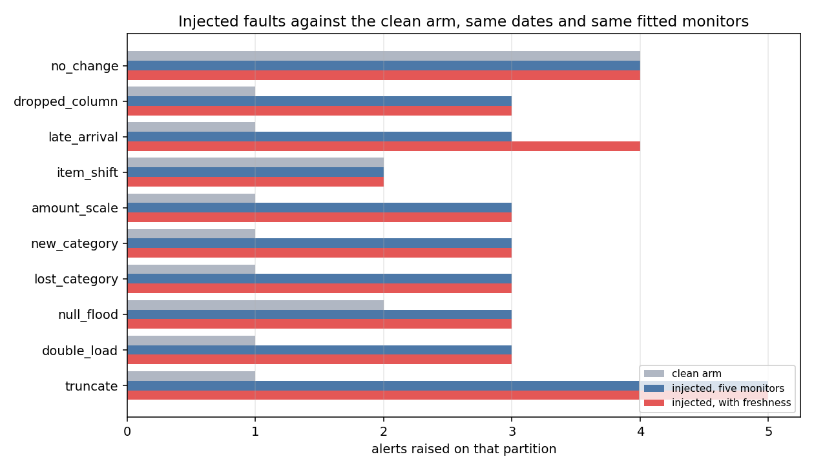
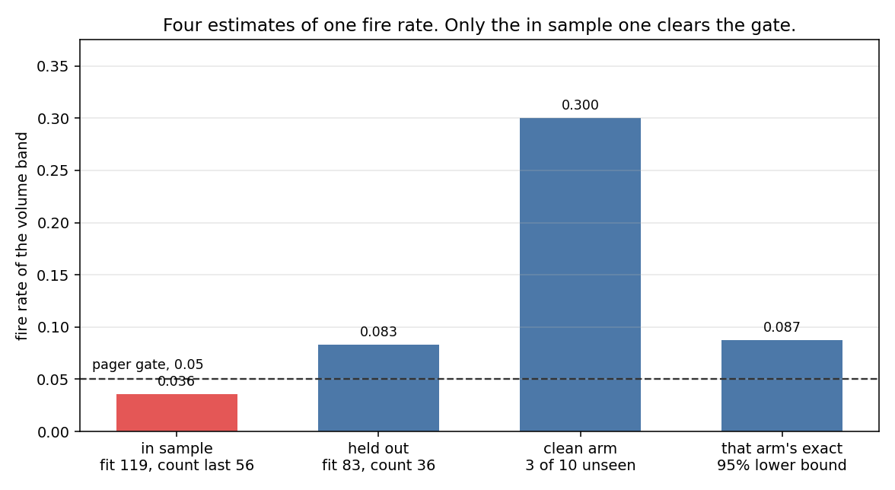

# pipeline-observability

Catch a broken data pipeline before the dashboard consumers do. This repo holds a small
orders pipeline and the run-metadata schema that watches it. Freshness and volume and
schema and distribution monitors are built on top of that metadata.

```
pip install -r requirements.txt
python -m pipeline.generate --start 2026-03-02 --end 2026-06-28 --out data/raw
python scripts/run_observed.py --start 2026-03-02 --end 2026-06-28
python -m tests.run_all
```

`pipeline.run` runs the same pipeline with nothing watching it. Keeping both is what makes
the cost of the collector measurable.

## Where the pieces sit

```
  data/raw/dt=YYYY-MM-DD/orders.jsonl        generated source events
        |
        |  pipeline.orders.load_raw          declared columns, partition overwrite
        v
  raw_orders  ----------------------------->  obs_dataset_metric
        |            obs.collect              obs_column_metric
        |  pipeline.orders.build_daily        obs_schema_version
        v            obs.tracker              obs_run
  daily_orders                                       |
                                                     v
                                       obs.history  ->  obs.baseline
                                                     |
                                                     v
                                    drift, alerts, freshness, timeline
                                                     |
                                                     v
                                      quarantine  ->  the incident view
```

The observability side is `obs/`. The thing being observed is `pipeline/`. They do not
import each other and that separation is the point. `scripts/run_observed.py` is the only
file that knows about both. The collector reaches into the pipeline's warehouse from the
outside, the same way it would have to if the pipeline were a dbt project or someone
else's job.

## Results

The orders feed is generated, 254,952 rows over 119 daily partitions. Every figure here
comes out of one of five scripts in `scripts/`, and the design notes name which.

**Eight of nine injected faults were detected, and the control arm is the reason that
number means anything.** Each fault runs beside a clean copy of the same partitions, and a
fault only counts if it fires a subject the clean arm did not. Only six of the nine were
caught by the monitor named for them beforehand.



**238 of 249 alerts were the monitor talking about itself.** Two signals on one column could
not be banded, so every partition raised two alerts saying so. Saying it once at fit time
took the clean history from 249 alerts to 11.

**The gate meant to keep noisy signals off the pager refused nothing.** Zero of eighteen
watched signals. Then the fire rate that approved the ten that can page turned out to be
measured on its own training data. Measured on held out partitions, volume no longer pages
on this feed, including on the partial day fault it was built for.



**The duration band learned the speed of a filesystem.** The same thirty partitions, byte
identical, loaded at a median of 13.66 ms off the mounted folder and 4.03 ms off `/tmp`. A
duration band here is a property of the pipeline plus wherever its input sat. Duration is
still collected and banded, and it no longer reaches a person.

## Known limitations

- The source data is generated, and its weekly shape is assumed rather than observed.
- Every monitor is fitted once and never refitted.
- Faults are injected one per partition. Real incidents arrive together.
- The volume band has no trend term, so it is fitted on a series that is drifting.
- A real duration regression will not reach anyone, because duration is quarantined.
- A quarter of a distribution can move without the schema noticing.
- The Snowflake DDL has never run, and there is no Airflow yet.

The full list is in [docs/limitations.md](docs/limitations.md).

## More detail

**[Design notes](docs/design-notes.md)**

- [The metadata schema](docs/design-notes.md#the-metadata-schema)
- [The pipeline being watched](docs/design-notes.md#the-pipeline-being-watched)
- [The collector](docs/design-notes.md#the-collector)
- [Measured on this machine](docs/design-notes.md#measured-on-this-machine)
- [The baseline](docs/design-notes.md#the-baseline)
  - [The seasonal key is a property of the series, not of the project](docs/design-notes.md#the-seasonal-key-is-a-property-of-the-series-not-of-the-project)
  - [Four of seven `build_daily` bands had no width at all](docs/design-notes.md#four-of-seven-build_daily-bands-had-no-width-at-all)
  - [The median is the default, and the reason is a number](docs/design-notes.md#the-median-is-the-default-and-the-reason-is-a-number)
  - [The first run of the process, and why it cannot be absorbed](docs/design-notes.md#the-first-run-of-the-process-and-why-it-cannot-be-absorbed)
  - [A third of the band is trend, not noise](docs/design-notes.md#a-third-of-the-band-is-trend-not-noise)
  - [Seventeen observations per weekday is not many](docs/design-notes.md#seventeen-observations-per-weekday-is-not-many)
  - [What ships](docs/design-notes.md#what-ships)
- [Distribution drift](docs/design-notes.md#distribution-drift)
  - [distinct_count is the volume monitor with a different name](docs/design-notes.md#distinct_count-is-the-volume-monitor-with-a-different-name)
  - [seven quantiles cannot answer the question, and the size of the hole is exactly 0.25](docs/design-notes.md#seven-quantiles-cannot-answer-the-question-and-the-size-of-the-hole-is-exactly-025)
  - [the volume trend problem does not transfer here, and a smaller one does](docs/design-notes.md#the-volume-trend-problem-does-not-transfer-here-and-a-smaller-one-does)
  - [a signal that has never moved is held as a constant, not as a band](docs/design-notes.md#a-signal-that-has-never-moved-is-held-as-a-constant-not-as-a-band)
  - [fire rates, on training data](docs/design-notes.md#fire-rates-on-training-data)
- [Alerting](docs/design-notes.md#alerting)
  - [routing to a severity is the easy half, and it is the half that does nothing](docs/design-notes.md#routing-to-a-severity-is-the-easy-half-and-it-is-the-half-that-does-nothing)
  - [the fire rate that approved those ten pages was a tautology](docs/design-notes.md#the-fire-rate-that-approved-those-ten-pages-was-a-tautology)
  - [and the same fix skipped the only subject that could actually page](docs/design-notes.md#and-the-same-fix-skipped-the-only-subject-that-could-actually-page)
  - [238 of 249 alerts were the monitor talking about itself](docs/design-notes.md#238-of-249-alerts-were-the-monitor-talking-about-itself)
  - [the cold start label exists now, and it does not justify a suppression rule](docs/design-notes.md#the-cold-start-label-exists-now-and-it-does-not-justify-a-suppression-rule)
  - [two bands, which is where the trend problem landed](docs/design-notes.md#two-bands-which-is-where-the-trend-problem-landed)
  - [the three silences, and only two of them are checkable](docs/design-notes.md#the-three-silences-and-only-two-of-them-are-checkable)
  - [suppression caps, it does not delete](docs/design-notes.md#suppression-caps-it-does-not-delete)
  - [what ships, and what is not yet tested](docs/design-notes.md#what-ships-and-what-is-not-yet-tested)
  - [the alert counts published here were never reproducible](docs/design-notes.md#the-alert-counts-published-here-were-never-reproducible)
- [Injected failures, and the control arm that mattered more](docs/design-notes.md#injected-failures-and-the-control-arm-that-mattered-more)
  - [the control arm is the finding, not the detection column](docs/design-notes.md#the-control-arm-is-the-finding-not-the-detection-column)
  - [the duration baseline learned the speed of a filesystem](docs/design-notes.md#the-duration-baseline-learned-the-speed-of-a-filesystem)
  - [the tracker was timing its own metadata write](docs/design-notes.md#the-tracker-was-timing-its-own-metadata-write)
  - [the holdout leaked its own reference](docs/design-notes.md#the-holdout-leaked-its-own-reference)
  - [what the faults found](docs/design-notes.md#what-the-faults-found)
  - [the timeline](docs/design-notes.md#the-timeline)
- [Three worked incidents](docs/design-notes.md#three-worked-incidents)
  - [the incident view did not know which of its lines meant anything](docs/design-notes.md#the-incident-view-did-not-know-which-of-its-lines-meant-anything)
  - [a subject that fires on every clean partition is now held out entirely](docs/design-notes.md#a-subject-that-fires-on-every-clean-partition-is-now-held-out-entirely)
  - [incident one, a partial day. the monitor works and the view still needed help](docs/design-notes.md#incident-one-a-partial-day-the-monitor-works-and-the-view-still-needed-help)
  - [incident two, a column disappears. the monitor named for it cannot see it](docs/design-notes.md#incident-two-a-column-disappears-the-monitor-named-for-it-cannot-see-it)
  - [incident three, late arrival. detected, and this repo cannot repair it](docs/design-notes.md#incident-three-late-arrival-detected-and-this-repo-cannot-repair-it)
- [Three loose ends, and what I did with them](docs/design-notes.md#three-loose-ends-and-what-i-did-with-them)
  - [duration is not comparable across filesystems](docs/design-notes.md#duration-is-not-comparable-across-filesystems)
  - [the metadata schema is create only](docs/design-notes.md#the-metadata-schema-is-create-only)
  - [the restatement window](docs/design-notes.md#the-restatement-window)
  - [every monitor is fitted once and never refitted](docs/design-notes.md#every-monitor-is-fitted-once-and-never-refitted)

**[Running the checks](docs/running-the-checks.md)**
